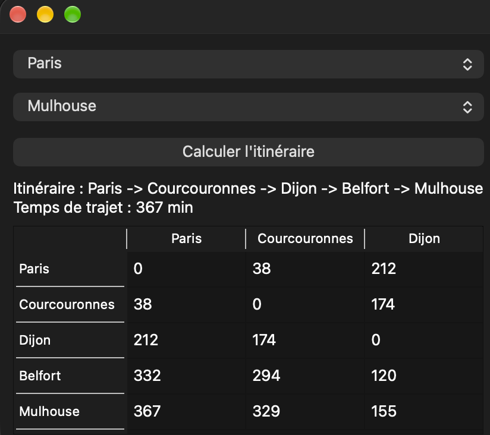

# RouteManager

Application de bureau (C++ / Qt) qui calcule le **temps de trajet en voiture entre deux villes de France** et affiche l'itinéraire le plus rapide, étape par étape.

Projet réalisé en 1re année de BUT Informatique, seul. Stack : C++17, Qt 6 (Widgets), algorithme de Floyd-Warshall.



## Fonctionnement

- Les 100 villes et 542 routes directes (avec leur durée en minutes) sont lues dans deux fichiers CSV embarqués dans l'application.
- Au démarrage, l'algorithme de **Floyd-Warshall** calcule le plus court temps entre **toutes** les paires de villes, et mémorise pour chaque paire la prochaine étape à suivre.
- L'utilisateur choisit une ville de départ et une ville d'arrivée, puis clique sur « Calculer l'itinéraire ».
- L'application affiche l'itinéraire (`Paris -> Lyon -> ... -> Nice`), le temps total, et un tableau des temps entre les villes traversées.

Exemple : Paris → Nice, 622 minutes, via Courcouronnes, Lyon, Valence et Aix-en-Provence.

## Structure du code

| Fichier | Rôle |
|---|---|
| `routemanager.h/.cpp` | Logique : chargement des CSV, Floyd-Warshall, reconstruction du chemin. Ne dépend pas de l'interface. |
| `city.h` | Structure `City` (identifiant, nom, latitude, longitude). |
| `mainwindow.h/.cpp` | Interface Qt : listes de villes, bouton, résultat, tableau. |
| `main.cpp` | Point d'entrée. |
| `villes.csv`, `temps.csv` | Données, embarquées via `Ressource.qrc`. |

La logique (`RouteManager`) est séparée de l'interface (`MainWindow`) : la première ne connaît pas Qt, sauf pour lire les fichiers embarqués.

## Compiler et lancer

Prérequis : Qt 6 (avec qmake) et un compilateur C++17.

```bash
qmake6 SAE_RouteManager.pro
make
./SAE_RouteManager.app/Contents/MacOS/SAE_RouteManager   # macOS
```

Ou ouvrir `SAE_RouteManager.pro` dans Qt Creator et lancer.

## Limites connues

- Le nombre maximal de villes est fixé à 200 dans le code (taille des matrices).
- Les CSV sont découpés au niveau des virgules, sans gérer les champs entre guillemets : cela suffit pour ces fichiers, mais pas pour des données quelconques.
- Les temps viennent du graphe fourni : les villes non reliées directement sont estimées par composition de trajets, pas par un vrai calcul d'itinéraire routier.

## Usage de l'IA

J'ai utilisé Claude comme **guide**, pas pour générer le code.

- **Ce que j'ai fait moi-même** : tout le code C++ et Qt. L'algorithme de Floyd-Warshall avait été vu en cours de maths ; le sujet demandait de le programmer.
- **Ce que l'IA a fait** : m'aider à comprendre l'algorithme et certaines notions, relire mon code, corriger mes erreurs et m'indiquer où je me trompais.
- **Une seule exception** : avant la mise en ligne, Claude a corrigé le chargement des fichiers CSV (une petite fonction de lecture dans `routemanager.cpp` et les chemins dans `mainwindow.cpp`), car mon code utilisait un chemin absolu propre à mon ordinateur. Le reste du code est le mien.

## Données

- `villes.csv` : dérivé de [Simplemaps World Cities](https://simplemaps.com/data/world-cities).
- `temps.csv` : temps de trajet issus d'[OpenStreetMap](https://www.openstreetmap.org/copyright) (© contributeurs OpenStreetMap, licence ODbL).

Fichiers fournis dans le cadre du sujet.

## Licence

Code sous licence MIT, voir [LICENSE](LICENSE). Les données restent soumises à leurs licences d'origine.
